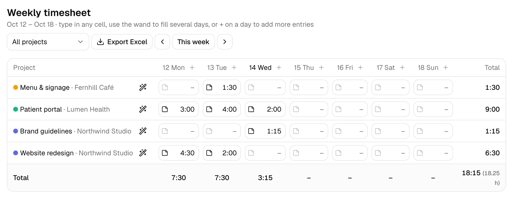

# UseHourly

**A simple timesheet for freelancers.** Log your day in seconds: type `1.5`, `1:30` or `90m`, press Enter, done.

**Live:** https://usehourly.app · Free to use, no paywall, no ads.

[](https://smithery.ai/servers/dzontak/usehourly)



## What it does

- **Quick entry.** Pick a project, type the time the way you would say it, add a note. Or press Start and let the timer count.
- **Weekly timesheet.** Every project and every day in one editable grid. Fill several days at once, add more entries to a day, move an entry to another date.
- **Month calendar** with per-project totals.
- **Invoices.** Turn billable hours into a PDF invoice, track paid and unpaid, re-download any time.
- **Annual report.** Hours, earnings, invoiced and received by quarter and month, ready for your accountant.
- **Export.** Excel for any week, month or custom date range (for example March 3 to April 20), and one zip with everything: every client, all time.
- **Try it first.** "Try it with sample data" on the home page opens a throwaway account filled with a month of work. No sign-up; keep it with one click if you like it.
- **Switching from Toggl or Clockify?** Import their CSV export from the Account page. Clients and projects are created for you, and importing the same file twice adds nothing.
- **Works with AI assistants (MCP).** Any MCP client (Claude, Cursor, VS Code, ChatGPT, your own agent) can log time, start timers and create invoices for you. See below.
- **Free calculator.** [Hours calculator](https://usehourly.app/tools/hours-calculator): add up times and get decimal hours, no account needed.
- **Your data is yours.** Per-user isolation; everything you log can be exported at any time.

## Use it from any AI assistant (MCP server)

UseHourly runs a remote [Model Context Protocol](https://modelcontextprotocol.io) server at `https://usehourly.app/api/mcp` (Streamable HTTP). It has 30 tools for projects, clients, time entries, timers, invoices and reports; each one runs as you, so it only sees your own data. Create a token on Account > AI assistants (read-only or read and write, with an expiry), then:

```bash
claude mcp add --transport http usehourly https://usehourly.app/api/mcp --header "Authorization: Bearer <your token>"
```

That example is for Claude Code. Other clients just need the URL and an `Authorization: Bearer <token>` header in their MCP settings.

Cursor (`~/.cursor/mcp.json`):

```json
{ "mcpServers": { "usehourly": { "url": "https://usehourly.app/api/mcp", "headers": { "Authorization": "Bearer <your token>" } } } }
```

VS Code (`.vscode/mcp.json`):

```json
{ "servers": { "usehourly": { "type": "http", "url": "https://usehourly.app/api/mcp", "headers": { "Authorization": "Bearer <your token>" } } } }
```

For clients that can only run local (stdio) servers, such as Claude Desktop, there is a small bridge published on npm ([`usehourly-mcp`](bridge/README.md)): set the command to `npx` with args `["-y", "usehourly-mcp"]` and `USEHOURLY_API_TOKEN` to your token.

Then ask: "Log 2 hours on the Acme website for yesterday" or "Make an invoice for Acme for September."

## Stack

Next.js 16 (App Router) · React 19 · Tailwind CSS v4 · shadcn/ui · NextAuth v5 (credentials) · tRPC v11 · Prisma 7 with Cloudflare D1 · Vitest · Biome · deployed to Cloudflare Workers with OpenNext.

## Run it locally

You need Node 22+.

```bash
npm install                 # also runs `prisma generate`

cp wrangler.example.jsonc wrangler.jsonc   # then set account_id and database_id (see Deploy)

# .env.local and .dev.vars (keep the two in sync):
#   AUTH_SECRET=<a long random string, e.g. `openssl rand -base64 32`>
#   AUTH_URL=http://localhost:3028

npm run d1:migrate:local    # create the local D1 database
npm run dev                 # http://localhost:3028
```

Register an account on the sign-up page and you are in.

```bash
npm test                    # scenario tests (Vitest)
npx biome check             # lint and format
npx tsc --noEmit            # type check
```

## Deploy

It runs on Cloudflare Workers with a D1 database:

1. `cp wrangler.example.jsonc wrangler.jsonc` and fill in your Cloudflare account id and a D1 database
   (`npx wrangler d1 create usehourly-db`). `wrangler.jsonc` is git-ignored, so your ids stay out of the repo.
2. Put your public address in `.env.production.local`: `NEXT_PUBLIC_APP_URL=https://app.example.com`
   (it is baked into the build) and set the same value as `AUTH_URL` in `wrangler.jsonc`.
3. `npm run d1:migrate:remote`
4. `npx wrangler secret put AUTH_SECRET`
5. `npm run deploy`

### Email (optional)

Password reset and email confirmation need an email service. UseHourly sends through
[Resend](https://resend.com): verify your sending domain there, then set two values on the Worker:

```bash
npx wrangler secret put RESEND_API_KEY
npx wrangler secret put EMAIL_FROM        # for example: UseHourly <noreply@your-domain.com>
```

Without them the app works as before, and the forgot-password page says email isn't set up.

### Deploy from CircleCI

`.circleci/config.yml` runs the checks on every push and, on `main`, applies the D1 migrations and
deploys. The deploy token is a secret, so keep it out of the project settings: create a **context**
named `usehourly-production` (Organization Settings > Contexts), add an expression restriction
`pipeline.git.branch == "main"`, and put the token in it. Only the deploy job on `main` can read it.

| Context variable | Value |
|---|---|
| `CLOUDFLARE_API_TOKEN` | a token with Workers Scripts: Edit and D1: Edit |

In the CircleCI project settings add these environment variables:

| Variable | Value |
|---|---|
| `CLOUDFLARE_ACCOUNT_ID` | your Cloudflare account id |
| `D1_DATABASE_ID` | the id of your D1 database |
| `APP_URL` | your public address, for example `https://app.example.com` |

Optional: `WORKER_NAME`, `D1_DATABASE_NAME`, `CUSTOM_DOMAIN`. `AUTH_SECRET` stays a Worker secret
(`npx wrangler secret put AUTH_SECRET`, once); CI never sees it. `scripts/ci-wrangler-config.mjs`
writes `wrangler.jsonc` from these variables, so no account ids live in the repository.

## Support

UseHourly is free. If it saves you time you can [sponsor it on GitHub](https://github.com/sponsors/Zontak-LLC).

### Supporters

Thank you to everyone who helps keep UseHourly free:

<!-- supporters:start -->
_Be the first: [sponsor UseHourly on GitHub](https://github.com/sponsors/Zontak-LLC)._
<!-- supporters:end -->

## Credits and license

Built on the excellent [next-shadcn-admin-dashboard](https://github.com/arhamkhnz/next-shadcn-admin-dashboard) template by Mohammed Arham Khan.

Released under the [MIT License](LICENSE). The code is open; the name "UseHourly" and its logo are not part of the license.
